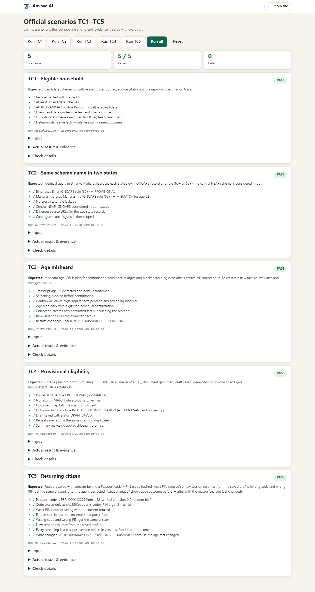

# Official test cases: evidence pack

Prepared 27 October 2026 from commit `ff3627f` (3,534 catalogue schemes, 17 reviewed rules, rule bundle `rules-2026.10.1`).
The brief asks to *run each scenario and capture the input, actual result and evidence, and explain any difference from the expected result.* This folder does exactly that.

## Summary

| Case | Scenario | Brief expects | Result | Checks | Page |
|---|---|---|---|---|---|
| TC1 | Eligible household | scheme list with rules quoted | ✅ PASS | 6/6 | [TC1.md](TC1.md) |
| TC2 | Same scheme name in two states | correct state used | ✅ PASS | 6/6 | [TC2.md](TC2.md) |
| TC3 | Age misheard | confirmed before filtering | ✅ PASS | 7/7 | [TC3.md](TC3.md) |
| TC4 | Provisional eligibility | never promised as a benefit | ✅ PASS | 7/7 | [TC4.md](TC4.md) |
| TC5 | Returning citizen | extra case | ✅ PASS | 8/8 | [TC5.md](TC5.md) |

**34 of 34 checks pass** across the five scenarios. A printable version with all screenshots is in [`Anvaya-test-evidence.pdf`](Anvaya-test-evidence.pdf) (same content as [`report.html`](report.html)).



## What each case shows

* **[TC1](TC1.md)**: a household's facts become a scheme list; every condition quotes the official sentence and links its source. Results are *provisional*, never "eligible".
* **[TC2](TC2.md)**: the same scheme name in Bihar and Maharashtra is screened against each state's own record (age 60+ vs 65+); nothing leaks across states, and the central scheme applies to both.
* **[TC3](TC3.md)**: a misheard age (26 instead of 62) is held, read back in digits, blocks screening, cannot be confirmed by "confirm all", and its correction recomputes the results.
* **[TC4](TC4.md)**: criteria pass but proof is missing, so the result is provisional, the document gap is listed, the draft is idempotent, and nothing is promised as a benefit.
* **[TC5](TC5.md)** (extra): a returning citizen resumes with a Passport code + PIN and sees what changed and why.

## Differences from the expected results, in one place

| Case | Difference | Why |
|---|---|---|
| TC1 | Results say "Provisional match", never "Eligible" | Documents are unverified and the rule sources are not yet checked by a data steward; the safety rules forbid promising a benefit |
| TC1 | Only schemes with a reviewed rule are screened (17 of 3,534) | The engine does not guess at schemes nobody has reviewed |
| TC2 | The same person gets different answers in the two states | The two official records set different age limits (60 vs 65); the central scheme still applies in both |
| TC3 | The mishearing is simulated | A real recognition error cannot be triggered on demand; the test proves the system's handling of a wrong age |
| TC3 | "Confirm all" does not confirm the age, income or state | Stronger than the brief: high-impact facts are confirmed one by one |
| TC4 | none | |

## How the evidence was produced (and how to reproduce it)

Each scenario is a function in [`backend/anvaya/testrunner.py`](../../backend/anvaya/testrunner.py) that drives the **real pipeline** (conversation → extraction → confirmation → rule engine → documents → draft) and records its input, the expected result,
the actual result and a list of named checks. The screenshots are taken by a browser driving the real web app with the same inputs. The whole pack is generated by one script from the recorded data (no number in these pages is typed by hand):

```
backend/.venv/Scripts/python.exe -m pip install playwright      # once; Chrome must be installed
backend/.venv/Scripts/python.exe scripts/capture_test_evidence.py
```

It uses a throwaway database with no Supabase, no LLM and no speech service, so it is repeatable. The same scenarios can be run by an admin on the app's `/test-runs` page, and `POST /api/v1/test-runs/TC1…TC5` returns the same record.
The automated test-suite also runs them (`backend/tests/test_api.py`).

## Files
`TC1.md … TC5.md` (one page per case) · `report.html` / `Anvaya-test-evidence.pdf` (printable) · `data/TCn.json` (raw records) · `data/environment.json` · `screenshots/` · `../../scripts/capture_test_evidence.py` (regenerates everything).
