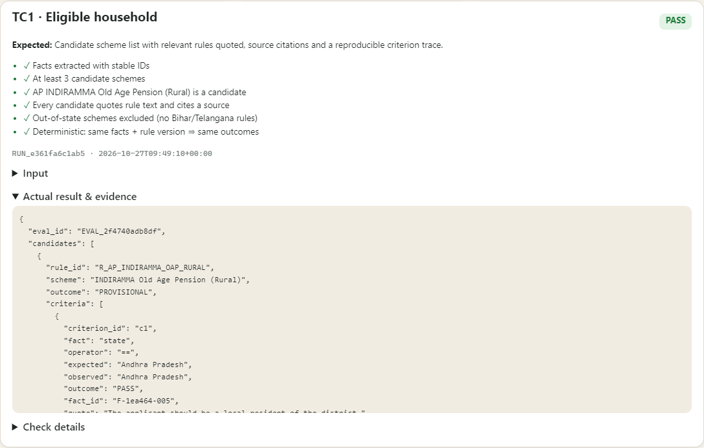
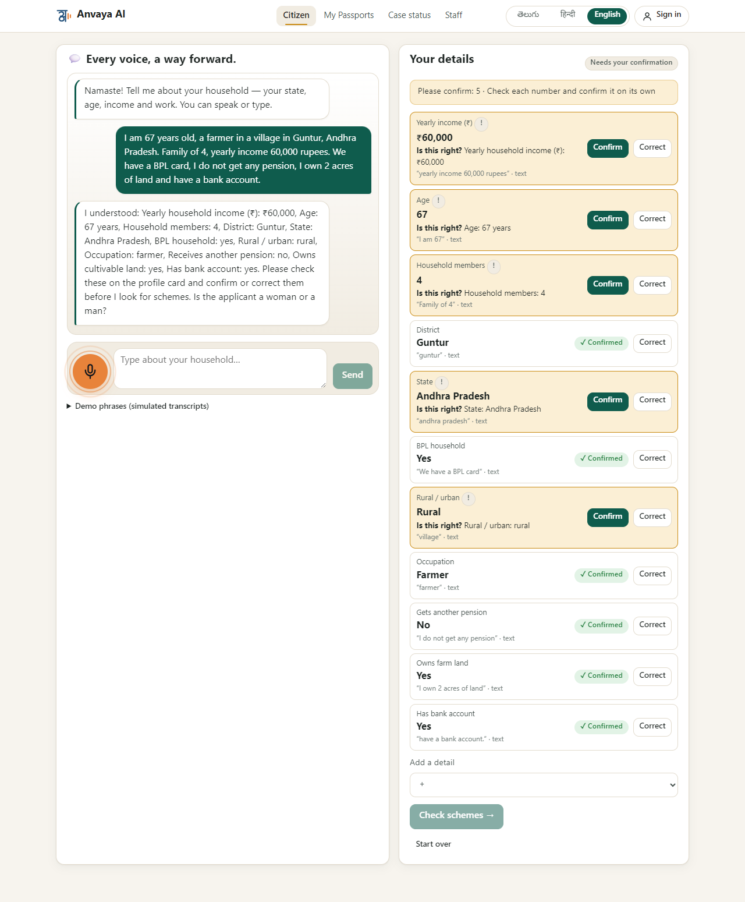
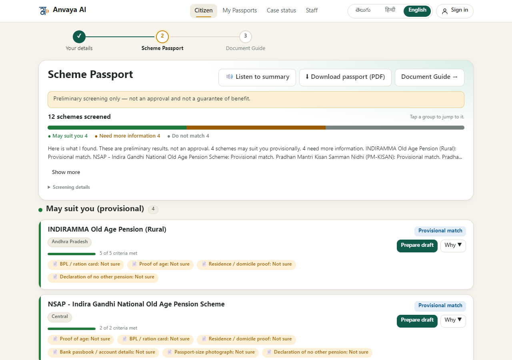
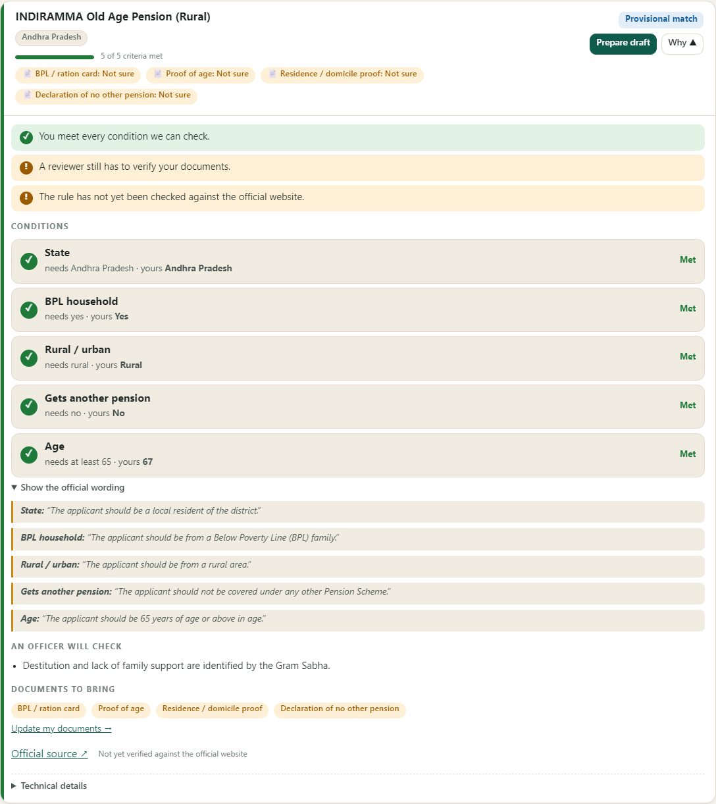
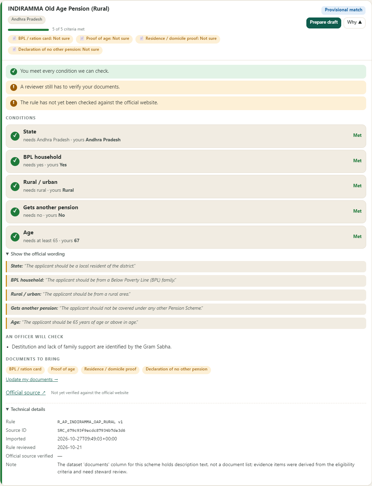

# TC1 · Eligible household

| | |
|---|---|
| **Brief expects** | scheme list with rules quoted |
| **Result** | ✅ PASS (6/6 checks) |
| **Run** | `RUN_b880ebfef025` · 2026-10-27T09:49:06+00:00 · evaluation `EVAL_47d3e36fcbc3` |

## Input
A citizen types (or says) in English:
> I am 67 years old, a farmer in a village in Guntur, Andhra Pradesh. Family of 4, yearly income 60,000 rupees. We have a BPL card, I do not get any pension, I own 2 acres of land and have a bank account.

## What the system did
It extracted the household's facts with stable ids, confirmed them, and screened them against the reviewed rules. **4 candidate schemes** came back,
every one with the official sentence for each condition quoted next to the citizen's fact, and the source link:

| Scheme | Condition | Needs | Citizen's fact | Result | Official wording (quoted) |
|---|---|---|---|---|---|
| INDIRAMMA Old Age Pension (Rural) | state | == Andhra Pradesh | Andhra Pradesh | PASS | “The applicant should be a local resident of the district.” |
| INDIRAMMA Old Age Pension (Rural) | bpl | yes | True | PASS | “The applicant should be from a Below Poverty Line (BPL) family.” |
| INDIRAMMA Old Age Pension (Rural) | area | == rural | rural | PASS | “The applicant should be from a rural area.” |
| INDIRAMMA Old Age Pension (Rural) | receives_other_pension | no | False | PASS | “The applicant should not be covered under any other Pension Scheme.” |
| INDIRAMMA Old Age Pension (Rural) | age | >= 65 | 67 | PASS | “The applicant should be 65 years of age or above in age.” |
| NSAP - Indira Gandhi National Old Age Pension Scheme | bpl | yes | True | PASS | “The applicant should belong to a Below Poverty Line (BPL) household.” |
| NSAP - Indira Gandhi National Old Age Pension Scheme | age | >= 60 | 67 | PASS | “The applicant should be 60 years of age or above.” |

(first two candidates shown; all 4 are in `data/TC1.json`.) Outcome of every rule screened: `R_AP_INDIRAMMA_OAP_RURAL` PROVISIONAL, `R_NSAP_IGNOAPS` PROVISIONAL, `R_PM_KISAN` PROVISIONAL, `R_PMSBY` PROVISIONAL, `R_AP_INDIRAMMA_WIDOW_RURAL` INSUFFICIENT_INFORMATION, `R_IGNWPS` INSUFFICIENT_INFORMATION, `R_PMUY_2` INSUFFICIENT_INFORMATION, `R_AP_SPECTACLES_SENIOR` NEEDS_HUMAN_REVIEW, `R_APY` MISMATCH, `R_AP_INDIRAMMA_OAP_URBAN` MISMATCH, `R_PMAY_URBAN` MISMATCH, `R_PMJJBY` MISMATCH.

## Evidence
| # | Check | Result |
|---|---|---|
| 1 | Facts extracted with stable IDs | ✅ pass |
| 2 | At least 3 candidate schemes | ✅ pass |
| 3 | AP INDIRAMMA Old Age Pension (Rural) is a candidate | ✅ pass |
| 4 | Every candidate quotes rule text and cites a source | ✅ pass |
| 5 | Out-of-state schemes excluded (no Bihar/Telangana rules) | ✅ pass |
| 6 | Deterministic: same facts + rule version ⇒ same outcomes | ✅ pass |

Raw record: [`data/TC1.json`](data/TC1.json) · runner page: 

## Screenshots

*The conversation: what the citizen typed and the facts the bot understood (each must be confirmed)*

*The Scheme Passport: 12 schemes screened, grouped; every likely scheme says "Provisional match"*

*"Why this result": each condition, what the rule needs, what the citizen said, and the official wording quoted*

*The official source link, and the technical details (rule id, source id, dates) folded below*

## Difference from the expected result
Matches the brief: a scheme list, with each rule's own wording quoted and a source cited. Three things worth saying out loud:
1. **The label is "Provisional match", never "Eligible".** All 4 candidates are provisional because their required documents are not yet verified by a reviewer and each rule's source has not been verified against the official website by a data steward. This is deliberate (see TC4). The scenario's name ("Eligible household") describes the household, not a promise the system makes.
2. **Only schemes with a reviewed rule can be screened.** The catalogue holds 3,534 schemes and can be searched, but the screening engine evaluates the 17 rules that have been written and reviewed; the rest are not guessed at.
3. **The input is typed text.** The speech path is exercised in TC3 with a simulated transcript; real microphone accuracy depends on the speech service and is not something this test can promise.
