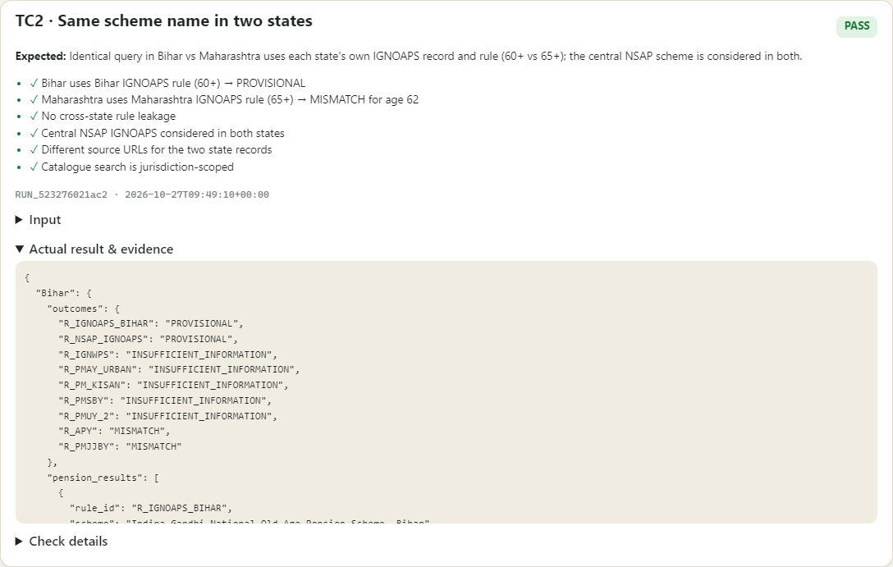
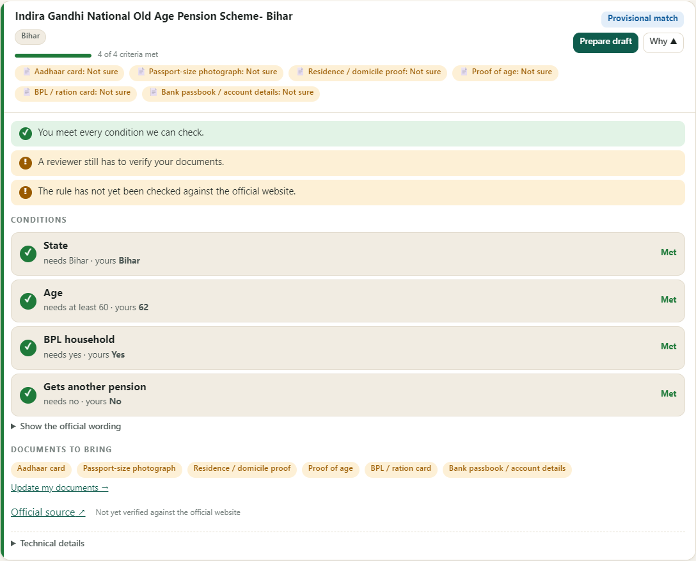
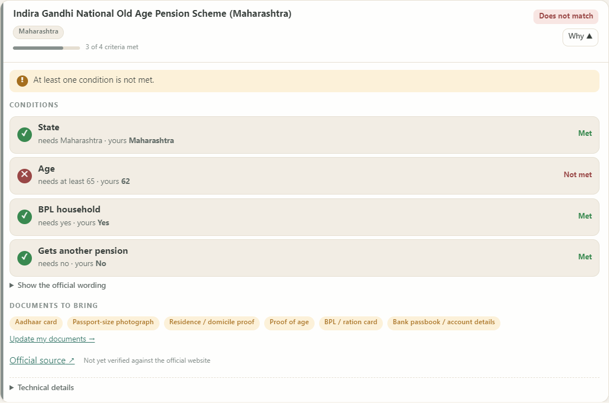

# TC2 · Same scheme name in two states

| | |
|---|---|
| **Brief expects** | correct state used |
| **Result** | ✅ PASS (6/6 checks) |
| **Run** | `RUN_b7154565b16e` · 2026-10-27T09:49:06+00:00 |

## Input
The same sentence twice, once per state:
> I am 62 years old, BPL household, I do not get any pension. I live in {state}.  with `{state}` = **Bihar**, then **Maharashtra**.

## What the system did
"Indira Gandhi National Old Age Pension Scheme" exists in both states' records with different rules and different official sources. Each citizen was screened against **their own state's** record:

| Rule | Scheme record | Outcome | Age condition |
|---|---|---|---|
| R_IGNOAPS_BIHAR | Indira Gandhi National Old Age Pension Scheme- Bihar | PROVISIONAL | age >= 60 (citizen: 62) → PASS |
| R_NSAP_IGNOAPS | NSAP - Indira Gandhi National Old Age Pension Scheme | PROVISIONAL | age >= 60 (citizen: 62) → PASS |
| R_NSAP_IGNOAPS | NSAP - Indira Gandhi National Old Age Pension Scheme | PROVISIONAL | age >= 60 (citizen: 62) → PASS |
| R_IGNOAPS_MAHARASHTRA | Indira Gandhi National Old Age Pension Scheme (Maharashtra) | MISMATCH | age >= 65 (citizen: 62) → FAIL |

* Bihar's record needs age ≥ 60 → a 62-year-old passes. Maharashtra's needs ≥ 65 → the same 62-year-old does **not** match the state scheme.
* The **central** scheme (`R_NSAP_IGNOAPS`, age ≥ 60) is considered for both citizens: Bihar → PROVISIONAL, Maharashtra → PROVISIONAL.
* No rule from the other state leaked in; the two state records cite different source documents.

## Evidence
| # | Check | Result |
|---|---|---|
| 1 | Bihar uses Bihar IGNOAPS rule (60+) → PROVISIONAL | ✅ pass |
| 2 | Maharashtra uses Maharashtra IGNOAPS rule (65+) → MISMATCH for age 62 | ✅ pass |
| 3 | No cross-state rule leakage | ✅ pass |
| 4 | Central NSAP IGNOAPS considered in both states | ✅ pass |
| 5 | Different source URLs for the two state records | ✅ pass |
| 6 | Catalogue search is jurisdiction-scoped | ✅ pass |

Raw record: [`data/TC2.json`](data/TC2.json) · runner page: 

## Screenshots

*Bihar: the Bihar record is used (age ≥ 60) and the condition is met*

*Maharashtra: the Maharashtra record is used (age ≥ 65) and the age condition is not met for a 62-year-old*

## Difference from the expected result
Matches the brief: the correct state's record is used in each case. One thing to know: the **same person gets a different answer in the two states** (provisional in Bihar, "does not match" for Maharashtra's state scheme) because the two official records really do set different age limits (60 vs 65); the central NSAP scheme still shows as a provisional match in Maharashtra, so the citizen is not left with nothing. The thresholds come from the scheme text in the dataset, quoted in the "Why this result" panel.
