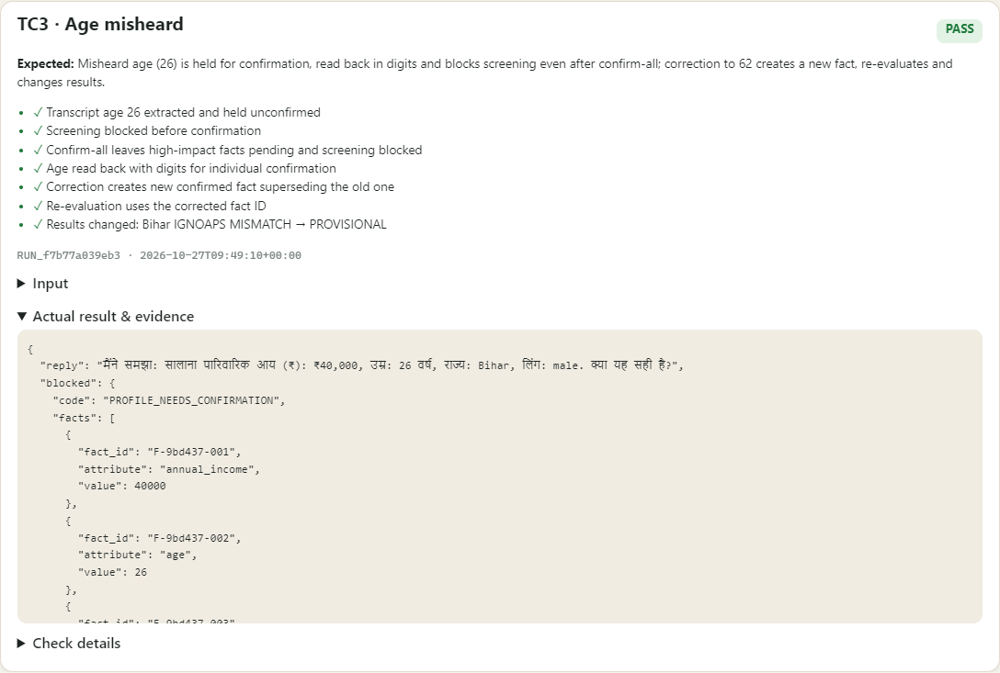
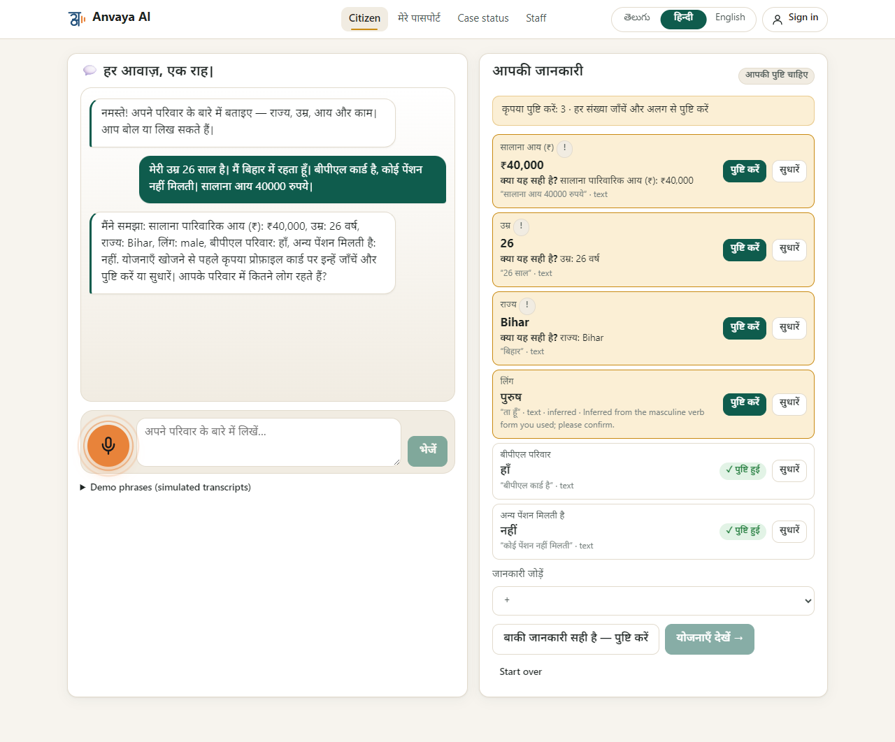
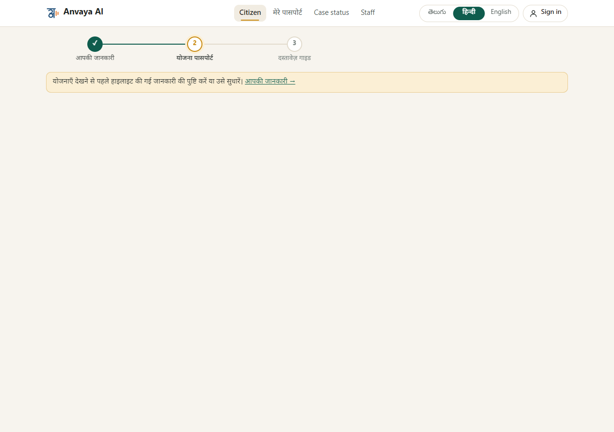
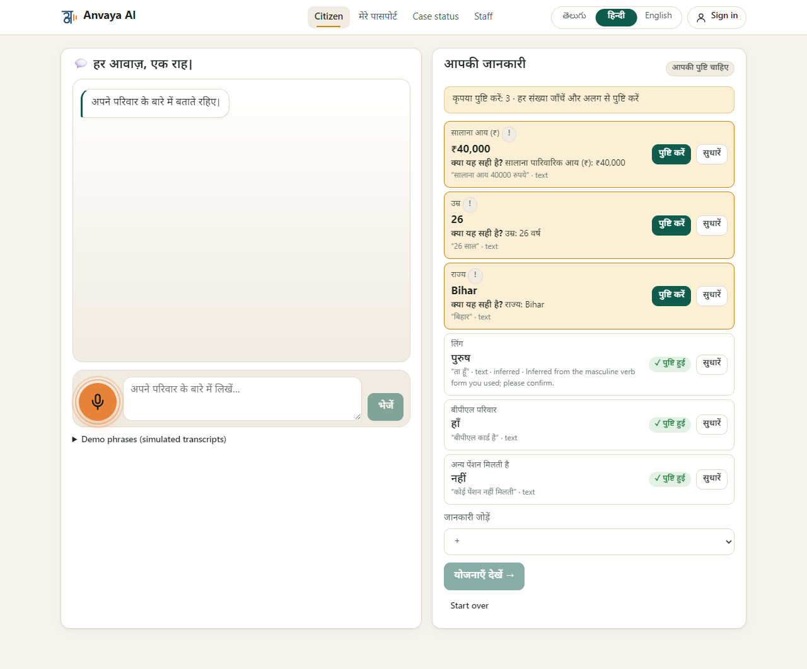
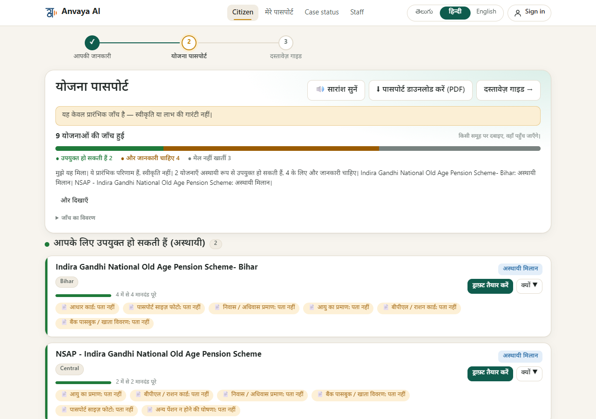

# TC3 · Age misheard

| | |
|---|---|
| **Brief expects** | confirmed before filtering |
| **Result** | ✅ PASS (7/7 checks) |
| **Run** | `RUN_88d324a85d48` · 2026-10-27T09:49:06+00:00 |

## Input
A Hindi voice transcript in which the speaker's age arrives as **26** (the real age is 62):
> मेरी उम्र 26 साल है। मैं बिहार में रहता हूँ। बीपीएल कार्ड है, कोई पेंशन नहीं मिलती। सालाना आय 40000 रुपये।

## What the system did
1. Read the transcript, held the age (and income, state) as **unconfirmed** and read the age back **in digits**: “उम्र: 26 वर्ष”.
2. **Blocked screening** with `PROFILE_NEEDS_CONFIRMATION` until those facts are confirmed.
3. "Confirm all" did **not** confirm the high-impact facts; it confirmed only 1 low-impact fact and left 3 (age, income, state) for individual confirmation.
4. The citizen **corrected** the age to 62: a new fact was created and the old one marked superseded (`F-e6bf5e-007`); the results were recomputed from the corrected fact:

| Rule | With the misheard age (26) | After the correction (62) |
|---|---|---|
| `R_IGNOAPS_BIHAR` | MISMATCH | PROVISIONAL |
| `R_NSAP_IGNOAPS` | MISMATCH | PROVISIONAL |
| `R_IGNWPS` | MISMATCH | INSUFFICIENT_INFORMATION |
| `R_APY` | INSUFFICIENT_INFORMATION | MISMATCH |
| `R_PMJJBY` | INSUFFICIENT_INFORMATION | MISMATCH |

## Evidence
| # | Check | Result |
|---|---|---|
| 1 | Transcript age 26 extracted and held unconfirmed | ✅ pass |
| 2 | Screening blocked before confirmation | ✅ pass |
| 3 | Confirm-all leaves high-impact facts pending and screening blocked | ✅ pass |
| 4 | Age read back with digits for individual confirmation | ✅ pass |
| 5 | Correction creates new confirmed fact superseding the old one | ✅ pass |
| 6 | Re-evaluation uses the corrected fact ID | ✅ pass |
| 7 | Results changed: Bihar IGNOAPS MISMATCH → PROVISIONAL | ✅ pass |

Raw record: [`data/TC3.json`](data/TC3.json) (includes the full fact history) · runner page: 

## Screenshots (the app in Hindi)

*The misheard age is held for confirmation and read back; nothing is used yet*

*Trying to check schemes now is refused: "confirm or correct the highlighted details first"*

*"Confirm the others" leaves the age (and income, state) pending: they must be confirmed one by one*

*After the age is corrected to 62 the results are recomputed: the Bihar pension schemes become provisional matches*

## Difference from the expected result
Matches the brief and goes a step further: facts are confirmed before any filtering, **and "confirm all" cannot confirm the high-impact ones.** Two honest notes:
1. **The mishearing is simulated.** The test injects a transcript that already contains the wrong age (channel "voice (simulated transcript)"), because a real speech-recognition error cannot be made to happen on demand. What the test proves is what the system does when it receives a wrong age.
2. The bot also guessed the speaker's gender (male) from the verb form "रहता हूँ"; that guess is marked *inferred* and also waits for confirmation, so it cannot filter anything unconfirmed.
