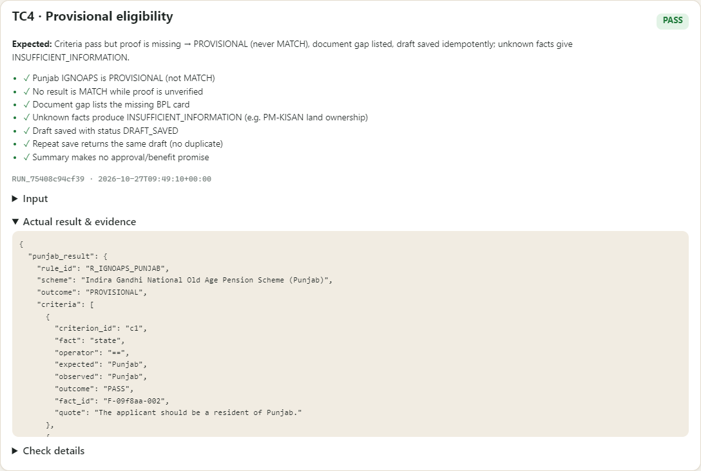
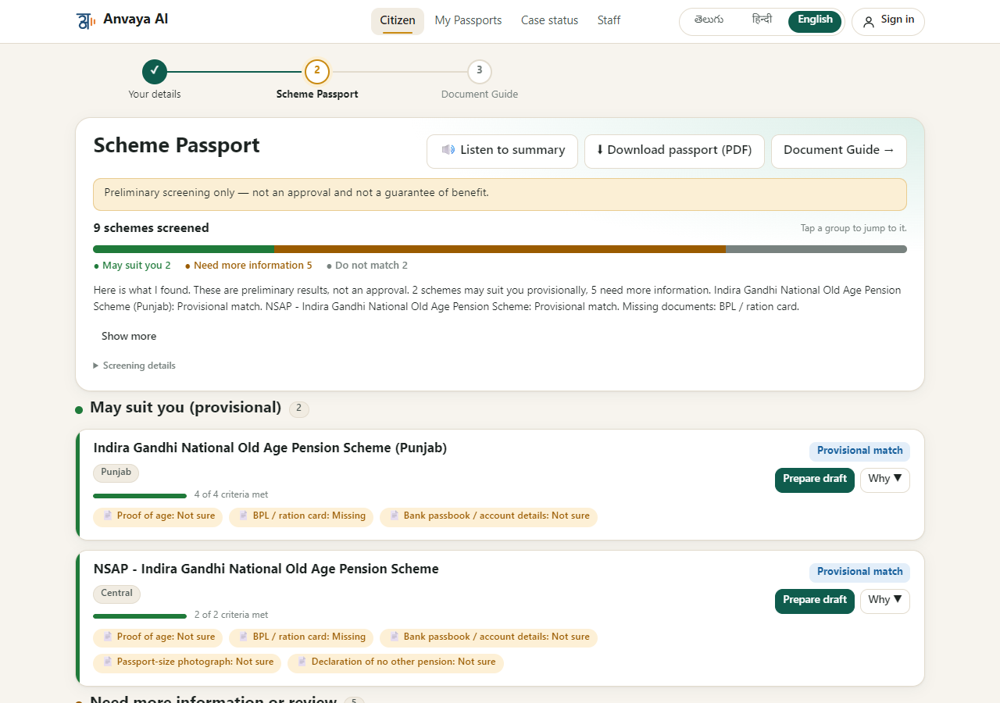
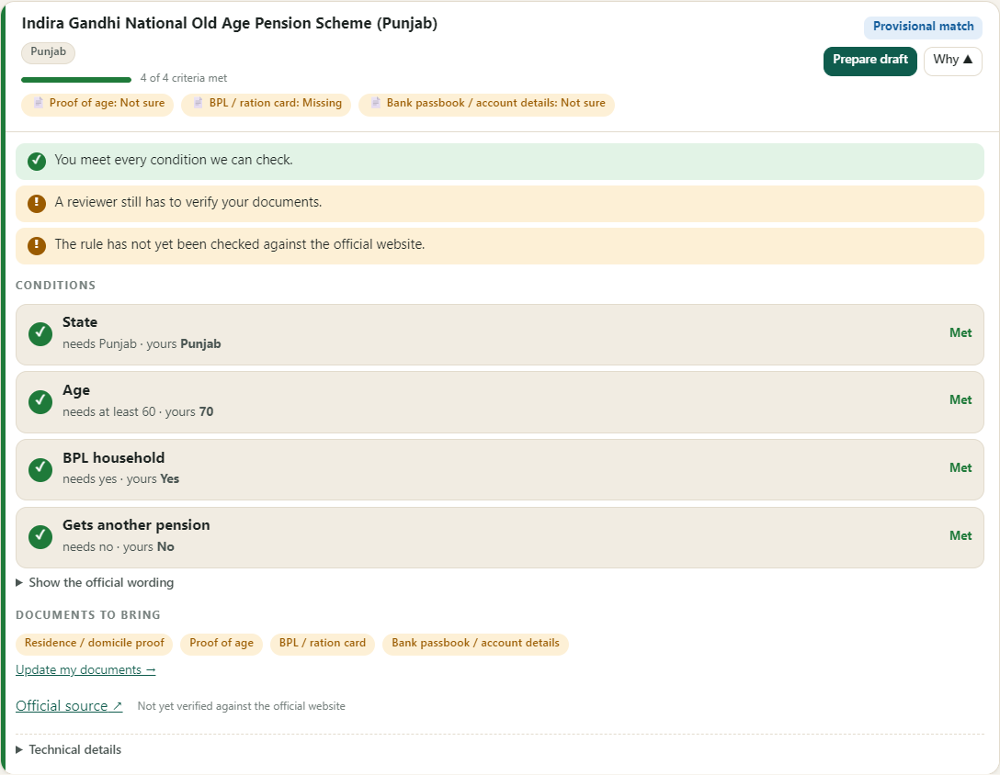
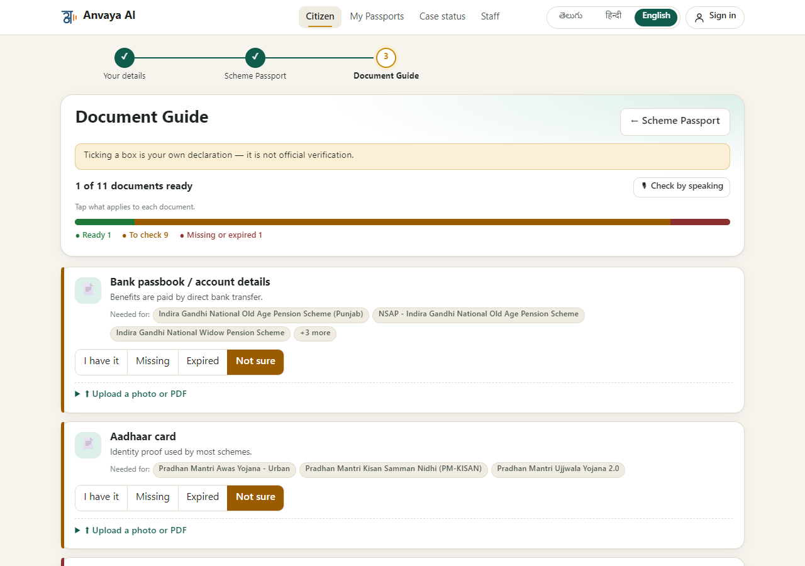
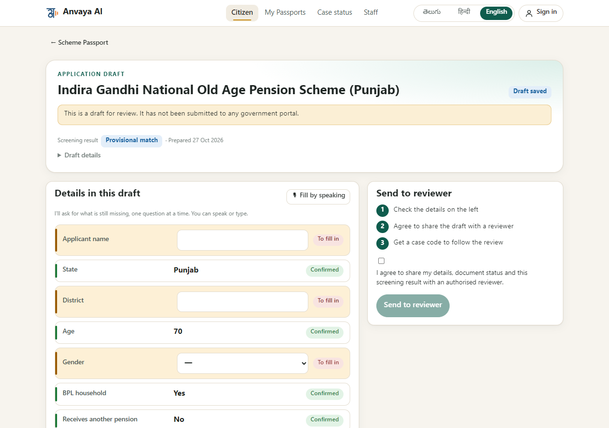

# TC4 · Provisional eligibility

| | |
|---|---|
| **Brief expects** | never promised as a benefit |
| **Result** | ✅ PASS (7/7 checks) |
| **Run** | `RUN_f870179f61ec` · 2026-10-27T09:49:06+00:00 |

## Input
> I am 70 years old and live in Punjab. We have a BPL card. I do not get any pension.

Document marks entered by the citizen: `bpl_card` = missing, `age_proof` = unknown, `residence_proof` = available.

## What the system did
| Scheme | Condition | Needs | Citizen's fact | Result | Official wording (quoted) |
|---|---|---|---|---|---|
| Indira Gandhi National Old Age Pension Scheme (Punjab) | state | == Punjab | Punjab | PASS | “The applicant should be a resident of Punjab.” |
| Indira Gandhi National Old Age Pension Scheme (Punjab) | age | >= 60 | 70 | PASS | “The applicant should be 60 years of age or older.” |
| Indira Gandhi National Old Age Pension Scheme (Punjab) | bpl | yes | True | PASS | “The applicant should be from a Below Poverty Line (BPL) family.” |
| Indira Gandhi National Old Age Pension Scheme (Punjab) | receives_other_pension | no | False | PASS | “The applicant should not be receiving pension benefits under any social security scheme.” |

Every condition passes, but the required documents are not verified by a reviewer, so the outcome is **PROVISIONAL**, never MATCH:
decision reasons `CRITERIA_PASSED, EVIDENCE_NOT_VERIFIED, SOURCE_NOT_VERIFIED`. The document gap lists `age_proof, bpl_card, bank_passbook`.
Rules whose facts are still unknown (e.g. PM-KISAN needs land ownership) answer `INSUFFICIENT_INFORMATION` instead of guessing. A draft was saved (`DRF_0508af246c32`) and saving again returned the **same** draft (no duplicate).

The spoken summary, word for word: “Here is what I found. These are preliminary results, not an approval. 2 schemes may suit you provisionally, 5 need more information. Indira Gandhi National Old Age Pension Scheme (Punjab): Provisional match. NSAP - Indira Gandhi N…”

## Evidence
| # | Check | Result |
|---|---|---|
| 1 | Punjab IGNOAPS is PROVISIONAL (not MATCH) | ✅ pass |
| 2 | No result is MATCH while proof is unverified | ✅ pass |
| 3 | Document gap lists the missing BPL card | ✅ pass |
| 4 | Unknown facts produce INSUFFICIENT_INFORMATION (e.g. PM-KISAN land ownership) | ✅ pass |
| 5 | Draft saved with status DRAFT_SAVED | ✅ pass |
| 6 | Repeat save returns the same draft (no duplicate) | ✅ pass |
| 7 | Summary makes no approval/benefit promise | ✅ pass |

Raw record: [`data/TC4.json`](data/TC4.json) · runner page: 

## Screenshots

*The Punjab pension is a "Provisional match"; the notice says it is not an approval and not a guarantee of benefit*

*"Why this result": every condition met, but "A reviewer still has to verify your documents"; the documents to bring are listed*

*The Document Guide shows the gap: the BPL card is marked missing*

*The draft is saved and clearly marked "not submitted to any government portal"*

## Difference from the expected result
None. The system never presents a result as a benefit: the only positive outcome is "Provisional match", the words "approval" and "guarantee" appear only to deny them ("Preliminary screening only — not an approval and not a guarantee of benefit"), and an automated check scans the spoken summary for promise wording. Every outcome here depends on documents a human reviewer would still have to verify.
