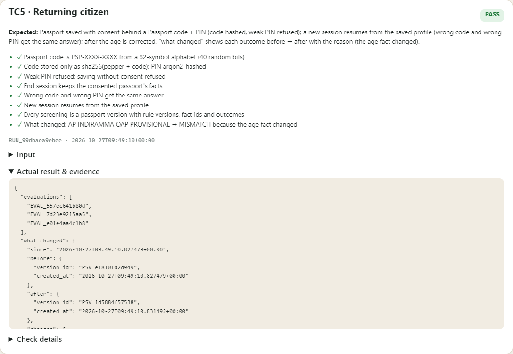

# TC5 · Returning citizen (extra: beyond the brief's four cases)

| | |
|---|---|
| **Result** | ✅ PASS (8/8 checks) |
| **Run** | `RUN_54472765af36` · 2026-10-27T09:49:07+00:00 |

The brief lists four cases; this fifth one covers the saved-passport journey (Passport code + PIN, resume, "what changed"). Passport saved with consent behind a Passport code + PIN (code hashed, weak PIN refused); a new session resumes from the saved profile (wrong code and wrong PIN get the same answer); after the age is corrected, "what changed" shows each outcome before → after with the reason (the age fact changed).

## Evidence
| # | Check | Result |
|---|---|---|
| 1 | Passport code is PSP-XXXX-XXXX from a 32-symbol alphabet (40 random bits) | ✅ pass |
| 2 | Code stored only as sha256(pepper + code); PIN argon2-hashed | ✅ pass |
| 3 | Weak PIN refused; saving without consent refused | ✅ pass |
| 4 | End session keeps the consented passport's facts | ✅ pass |
| 5 | Wrong code and wrong PIN get the same answer | ✅ pass |
| 6 | New session resumes from the saved profile | ✅ pass |
| 7 | Every screening is a passport version with rule versions, fact ids and outcomes | ✅ pass |
| 8 | What changed: AP INDIRAMMA OAP PROVISIONAL → MISMATCH because the age fact changed | ✅ pass |

"What changed" after the age was corrected to 52:

| Scheme | Before | After | Because |
|---|---|---|---|
| NSAP - Indira Gandhi National Old Age Pension Scheme | PROVISIONAL | MISMATCH | the age changed (67 → 52) |
| Sanctioning Spectacles to Senior Citizens | NEEDS_HUMAN_REVIEW | MISMATCH | the age changed (67 → 52) |
| INDIRAMMA Old Age Pension (Rural) | PROVISIONAL | MISMATCH | the age changed (67 → 52) |

Raw record: [`data/TC5.json`](data/TC5.json) · runner page: 

## Difference from the expected result
None. The PIN is never recorded in the evidence (the input shows "(4 digits, not recorded)"), and a wrong code and a wrong PIN deliberately get the same answer.
